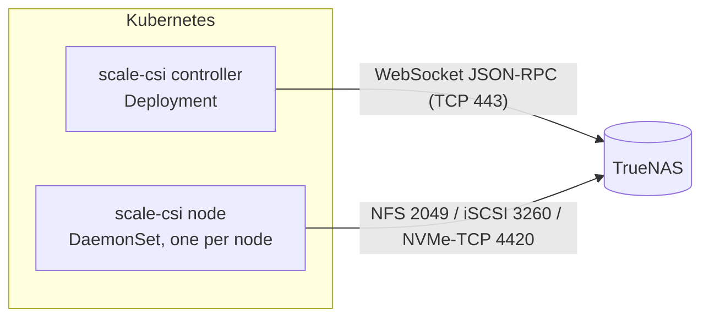

# Getting started

This guide takes you from nothing to a working, mounted PersistentVolumeClaim
backed by TrueNAS. Plan on 30–45 minutes. Every command can be copied as-is
once you replace the values in the table below.

| Placeholder | Meaning | Example used in this guide |
|---|---|---|
| TrueNAS API host | Hostname or IP the **controller** uses for the API | `truenas.example.com` |
| Storage IP | TrueNAS IP the **nodes** use for NFS/iSCSI/NVMe-oF traffic | `192.0.2.10` |
| Pool | An existing ZFS pool on TrueNAS | `tank` |
| Parent dataset | Dataset that will hold every volume | `tank/k8s/volumes` |
| Node network | CIDR of your Kubernetes nodes | `192.0.2.0/24` |



Only the controller talks to the TrueNAS API and holds the API key. Node pods
only mount storage.

## 1. Choose a protocol

| If you need… | Use |
|---|---|
| Shared (`ReadWriteMany`) volumes, simplest setup | `nfs` |
| Block storage on any Linux node | `iscsi` |
| The fastest block storage, on nodes with a reasonably modern kernel | `nvmeof` |

You can enable several protocols in one installation and pick per
StorageClass. This guide shows each one; follow the protocol-specific steps
only for the protocols you enable.

## 2. Prepare TrueNAS

Everything in this section is done once, on the TrueNAS side. The UI paths are
for TrueNAS 25.10 and later; menu labels can shift slightly between releases.
Each step also shows the equivalent `midclt` command, which you can run from
**System → Shell** (or over SSH) on the TrueNAS host.

### 2.1 Create the parent dataset

Create a dataset that belongs to scale-csi alone. The driver creates every
volume beneath it and never touches anything outside it.

UI: **Datasets → select the pool → Add Dataset**, create `k8s`, then create
`volumes` inside it.

```bash
midclt call pool.dataset.create '{"name": "tank/k8s"}'
midclt call pool.dataset.create '{"name": "tank/k8s/volumes"}'
```

> **Keep the parent dataset exclusive.**
>
> - Use one parent per Kubernetes cluster. Two clusters pointed at the same
>   parent would each see the other's volumes as orphans.
> - Exclude it from TrueNAS periodic-snapshot and replication tasks. Snapshots
>   the driver did not create make `DeleteVolume` refuse to delete a volume (a
>   deliberate safety check). If you need scheduled snapshots, use the driver's
>   own [`snapshotSchedule`](reference/storageclass.md#driver-managed-periodic-snapshots-gf2e2).

There is no separate snapshot dataset: CSI snapshots are ZFS snapshots of each
volume (`tank/k8s/volumes/<volume>@<snapshot>`).

### 2.2 Create a dedicated API user and key

scale-csi authenticates with an API key only. A key carries the roles of the
user it belongs to, so create a dedicated user with just the roles the driver
needs instead of using `root` or a full administrator.

The driver needs these four built-in roles:

| Role | Covers |
|---|---|
| `SHARING_ADMIN` | Datasets and zvols (create, update, query), NFS shares, iSCSI targets/extents/initiators, NVMe-oF subsystems/namespaces/ports/hosts, ACLs, service control, `system.info` |
| `REPLICATION_ADMIN` | Snapshots (create, clone, rename, hold/release), periodic-snapshot tasks, local send/receive for detached restores |
| `DATASET_DELETE` | Deleting volume datasets and zvols |
| `SNAPSHOT_DELETE` | Deleting snapshots |

This list was derived by matching every TrueNAS method the driver calls
against the role metadata of TrueNAS 26.0 (recorded in
[`truenas-api-methods.json`](reference/truenas-api-methods.json)).
`SHARING_ADMIN` and `REPLICATION_ADMIN` alone are **not** enough: without
`DATASET_DELETE` and `SNAPSHOT_DELETE`, deleting a PVC or a VolumeSnapshot
fails with a permission error. Role names can change between TrueNAS
releases; if a call is refused, the controller log names the method.

UI:

1. **Credentials → Users → Add**: username `scale-csi`, full name
   `scale-csi Kubernetes driver`, enable **Disable Password**, turn off SMB
   access, and let it create a primary group of the same name.
2. **Credentials → Groups → Privileges → Add**: name `scale-csi`, local group
   `scale-csi`, roles `SHARING_ADMIN`, `REPLICATION_ADMIN`, `DATASET_DELETE`,
   `SNAPSHOT_DELETE`, web shell off.
3. **API Keys** (user menu, top right → **My API Keys**, or **Credentials →
   API Keys**) → **Add**: name `scale-csi`, user `scale-csi`. Copy the key now;
   TrueNAS shows it only once.

The same with `midclt`:

```bash
# User with no password, no SMB access, and its own primary group
midclt call user.create '{"username": "scale-csi", "full_name": "scale-csi Kubernetes driver",
  "password_disabled": true, "smb": false, "group_create": true}'

# Privilege granting exactly the four roles to that group
GID=$(midclt call group.query '[["group", "=", "scale-csi"]]' '{"get": true}' | jq -r .gid)
midclt call privilege.create "{\"name\": \"scale-csi\", \"local_groups\": [${GID}],
  \"roles\": [\"SHARING_ADMIN\", \"REPLICATION_ADMIN\", \"DATASET_DELETE\", \"SNAPSHOT_DELETE\"],
  \"web_shell\": false}"

# API key for the user (printed once; store it in your secret manager)
midclt call api_key.create '{"name": "scale-csi", "username": "scale-csi"}' | jq -r .key
```

> Quick evaluation only: a key for a full-admin user also works. Do not keep
> it that way in production.

### 2.3 Check the API certificate

The chart connects over `wss://` on port 443 and verifies the certificate by
default. TrueNAS ships a self-signed certificate, so pick one:

- **Recommended:** install a certificate whose name matches the hostname you
  will use for `truenas.host` (**System → General Settings → GUI → GUI SSL
  Certificate**), signed by a CA your cluster trusts or whose PEM you pass in
  `truenas.caCert`.
- **Evaluation only:** set `truenas.skipTLSVerify=true`.

### 2.4 Enable the protocol services

Turn on and auto-start only the services for the protocols you will use
(**System → Services**, toggle **Running** and **Start Automatically**). The
driver creates every share, target, extent, subsystem, and namespace itself.

**NFS** — start the **NFS** service and keep NFSv4 enabled in its settings (it
is by default).

**iSCSI** — start the **iSCSI** service and create one portal for the driver to
use:

1. **Shares → Block (iSCSI) Shares Targets → Portals → Add**.
2. Listen on the **storage IP** (for example `192.0.2.10`) port `3260`.

The driver looks up the portal whose listen address is *exactly* the address
you configure as `iscsi.portal` (or `truenas.host` when that is unset). A
portal listening on `0.0.0.0` does not match. Use an IP literal for
`iscsi.portal`, not a hostname. The driver creates the initiator group it
needs.

**NVMe-oF** — start the **NVMe-oF** service (TrueNAS 25.10 or later). The driver
creates the NVMe/TCP port on the address you configure as `nvmeof.address`, so
there is nothing else to create. Use the storage IP literal.

### 2.5 Open the network path

| Port | From | To |
|---|---|---|
| TCP 443 | Kubernetes nodes running the controller | TrueNAS API |
| TCP 2049 (NFS), 3260 (iSCSI), 4420 (NVMe/TCP) | Every Kubernetes node | TrueNAS storage IP |

Keep storage ports reachable only from your node network. iSCSI and NVMe/TCP
are unencrypted.

## 3. Prepare the Kubernetes nodes

The node plugin runs the storage tools **on the host** (through small wrappers
that `chroot`/`nsenter` into the host). It does not install packages or load
modules, so every node that can run a pod with a scale-csi volume needs the
host tools for its protocol.

### NFS

The node image ships `mount.nfs`; the host only needs kernel NFS client
support, which practically every distribution kernel has. Installing the NFS
client package on the host is still recommended:

```bash
# Debian / Ubuntu
sudo apt-get install -y nfs-common
# RHEL / Rocky / Alma / Fedora
sudo dnf install -y nfs-utils
```

### iSCSI

```bash
# Debian / Ubuntu
sudo apt-get install -y open-iscsi
sudo systemctl enable --now iscsid

# RHEL / Rocky / Alma / Fedora
sudo dnf install -y iscsi-initiator-utils
sudo systemctl enable --now iscsid

# Verify: prints the version and this node's initiator name (iqn.…)
iscsiadm --version
sudo cat /etc/iscsi/initiatorname.iscsi
```

The chart mounts the host's `/etc/iscsi` and `/var/lib/iscsi` into the node
plugin. Optional dm-multipath needs more host setup; see
[iSCSI multipath host prerequisites](production.md#iscsi-multipath-host-prerequisites).

### NVMe-oF

```bash
# Debian / Ubuntu
sudo apt-get install -y nvme-cli
# RHEL / Rocky / Alma / Fedora
sudo dnf install -y nvme-cli

# Load the TCP transport now and on every boot
sudo modprobe nvme-tcp
echo nvme-tcp | sudo tee /etc/modules-load.d/nvme-tcp.conf

# Verify
nvme version
lsmod | grep nvme_tcp
nvme show-hostnqn     # you will need this value in step 5
```

### Immutable and minimal distributions

| Distribution | NFS | iSCSI | NVMe-oF |
|---|---|---|---|
| **Flatcar Container Linux** | Works out of the box | `iscsiadm` ships in the image; enable the daemon with `systemctl enable --now iscsid` (or a Butane/Ignition `systemd` unit) | `nvme` ships in the image; load `nvme-tcp` with a `/etc/modules-load.d/nvme-tcp.conf` file in your Ignition config. There is no `/etc/nvme/hostnqn`, but `nvme show-hostnqn` still returns a stable NQN |
| **Fedora CoreOS** | Works out of the box | Check with `rpm -q iscsi-initiator-utils`; if missing, `rpm-ostree install iscsi-initiator-utils` and reboot. Enable `iscsid` | Check with `rpm -q nvme-cli`; if missing, `rpm-ostree install nvme-cli`. Load `nvme-tcp` via `/etc/modules-load.d` in your Butane config |
| **Talos Linux** | Not validated | Not validated | Not validated |

Talos is not a supported target today: it ships no host `iscsiadm` or `nvme`
binary for the wrappers to call (Talos's `iscsi-tools` extension runs them in
an extension service instead), and the chart mounts the standard `/etc/iscsi`
and `/var/lib/iscsi` paths. If you try it, validate every protocol on your
exact Talos release first.

Maintainers run scale-csi in production on Flatcar; the Fedora CoreOS notes
are standard package guidance and are less exercised.

## 4. Create the namespace and API-key Secret

The node plugin needs privileged host access, so the namespace must allow
privileged pods:

```bash
kubectl create namespace scale-csi
kubectl label namespace scale-csi pod-security.kubernetes.io/enforce=privileged

kubectl -n scale-csi create secret generic truenas-api-key \
  --from-literal=api-key='<paste-the-api-key-from-step-2.2>'
```

The Secret must have the key `api-key`. Using an existing Secret (instead of
`truenas.apiKey` in values) keeps the key out of Helm release history; in a
GitOps setup create it with SOPS, Sealed Secrets, or External Secrets.

## 5. Install the chart

The chart is published as an OCI artifact at
`oci://ghcr.io/gizmotickler/charts/scale-csi`. Chart version `X.Y.Z` deploys
image `vX.Y.Z`. Without `--version`, Helm installs the latest release; for
anything beyond a trial, pin the version you reviewed (see the
[releases page](https://github.com/GizmoTickler/scale-csi/releases)).

Write a `values.yaml` for the protocol you chose. These are trimmed versions
of the files in [`examples/helm/`](../examples/helm/), which explain every
line.

**NFS:**

```yaml
truenas:
  host: truenas.example.com
  existingSecret: truenas-api-key
zfs:
  parentDataset: tank/k8s/volumes
nfs:
  enabled: true
  server: 192.0.2.10
  shareAllowedNetworks: [192.0.2.0/24]
iscsi:
  enabled: false
nvmeof:
  enabled: false
storageClasses:
  - name: scale-nfs
    protocol: nfs
    isDefault: false
    reclaimPolicy: Delete
    allowVolumeExpansion: true
    volumeBindingMode: Immediate
    mountOptions: [nfsvers=4.1, hard, noatime]
    extraParameters: {}
```

**iSCSI:**

```yaml
truenas:
  host: truenas.example.com
  existingSecret: truenas-api-key
zfs:
  parentDataset: tank/k8s/volumes
nfs:
  enabled: false
iscsi:
  enabled: true
  portal: 192.0.2.10          # must equal the portal's listen IP (step 2.4)
nvmeof:
  enabled: false
storageClasses:
  - name: scale-iscsi
    protocol: iscsi
    isDefault: false
    reclaimPolicy: Delete
    allowVolumeExpansion: true
    volumeBindingMode: WaitForFirstConsumer
    mountOptions: []
    extraParameters:
      csi.storage.k8s.io/fstype: ext4
```

**NVMe-oF:**

```yaml
truenas:
  host: truenas.example.com
  existingSecret: truenas-api-key
zfs:
  parentDataset: tank/k8s/volumes
nfs:
  enabled: false
iscsi:
  enabled: false
nvmeof:
  enabled: true
  address: 192.0.2.10
  # One entry per node: the output of `nvme show-hostnqn` on that node.
  subsystemHosts:
    - nqn.2014-08.org.nvmexpress:uuid:00000000-0000-0000-0000-000000000001
    - nqn.2014-08.org.nvmexpress:uuid:00000000-0000-0000-0000-000000000002
storageClasses:
  - name: scale-nvmeof
    protocol: nvmeof
    isDefault: false
    reclaimPolicy: Delete
    allowVolumeExpansion: true
    volumeBindingMode: WaitForFirstConsumer
    mountOptions: []
    extraParameters:
      csi.storage.k8s.io/fstype: xfs
```

To collect every node's host NQN without logging in to each node:

```bash
for node in $(kubectl get nodes -o name); do
  kubectl debug "$node" --attach -q --profile=sysadmin --image=busybox:1.37 -- \
    chroot /host nvme show-hostnqn
done
```

`kubectl debug` leaves a completed `node-debugger-*` pod per node in the
current namespace; delete them afterwards. The alternative to a host list is
publication fencing, which grants each node per volume
(`fencing.mode: strict`, see [production](production.md)), or
`nvmeof.subsystemAllowAnyHost: true`, which admits any initiator that can reach
the port and is only appropriate on an isolated storage network.

Install:

```bash
helm install scale-csi oci://ghcr.io/gizmotickler/charts/scale-csi \
  --namespace scale-csi \
  --values values.yaml
```

The values file is validated against the chart's JSON schema, so a typo in a
key fails the install instead of being ignored.

## 6. Verify the driver

```bash
# Controller (1 pod) and one node pod per schedulable node, all Running
kubectl -n scale-csi get pods -o wide

# The CSI driver is registered and every node reports it
kubectl get csidriver csi.scale.io
kubectl get csinode -o custom-columns='NODE:.metadata.name,DRIVERS:.spec.drivers[*].name'

# The controller connected to TrueNAS (no connection or authentication errors)
kubectl -n scale-csi logs deploy/scale-csi-controller -c scale-csi --tail=50

# Your StorageClass exists
kubectl get storageclass
```

If the controller is not `Ready`, it has not reached TrueNAS: check the host,
the certificate (step 2.3), and the API key. See
[Troubleshooting](troubleshooting.md#quick-diagnostics).

## 7. Create a test volume

Apply the test manifest for your protocol. Each one creates a 1 GiB PVC and a
pod that writes a file to it:

```bash
# Pick one
kubectl apply -f https://raw.githubusercontent.com/GizmoTickler/scale-csi/main/examples/workloads/nfs-pvc-pod.yaml
kubectl apply -f https://raw.githubusercontent.com/GizmoTickler/scale-csi/main/examples/workloads/iscsi-pvc-pod.yaml
kubectl apply -f https://raw.githubusercontent.com/GizmoTickler/scale-csi/main/examples/workloads/nvmeof-pvc-pod.yaml
```

The rest of this section uses the NFS names (`scale-nfs-test`); the iSCSI and
NVMe-oF manifests use `scale-iscsi-test` and `scale-nvmeof-test`.

```bash
# The PVC becomes Bound (iSCSI/NVMe-oF bind once the pod is scheduled)
kubectl get pvc scale-nfs-test

# The pod starts and can read what it wrote
kubectl wait --for=condition=Ready pod/scale-nfs-test --timeout=180s
kubectl exec scale-nfs-test -- cat /data/hello.txt
kubectl exec scale-nfs-test -- df -h /data
```

On TrueNAS the volume appears as a child of the parent dataset, named after
the PV:

```bash
kubectl get pv "$(kubectl get pvc scale-nfs-test -o jsonpath='{.spec.volumeName}')"
midclt call pool.dataset.query '[["id", "^", "tank/k8s/volumes/"]]' | jq -r '.[].id'
```

## 8. Clean up

```bash
kubectl delete pod scale-nfs-test
kubectl delete pvc scale-nfs-test
```

With `reclaimPolicy: Delete` the driver removes the dataset or zvol and its
share/target from TrueNAS. If it stays, `kubectl describe pv` and the
controller log say why (most often a snapshot the driver did not create).

To remove the driver itself, delete every scale-csi PVC first, then:

```bash
helm uninstall scale-csi --namespace scale-csi
```

Uninstalling the chart does not delete volumes on TrueNAS.

## Next steps

- [examples/](../examples/README.md) — more workloads (RWX, raw block,
  StatefulSets, snapshots, clones) and GitOps install manifests.
- [Snapshots and clones](guides/snapshots.md) — install the snapshot CRDs and
  take your first snapshot.
- [Production checklist](production.md) — HA, fencing, security, monitoring.
- [Upgrades](guides/upgrades.md) — upgrading the chart and TrueNAS.
- [StorageClass reference](reference/storageclass.md) — every parameter.
